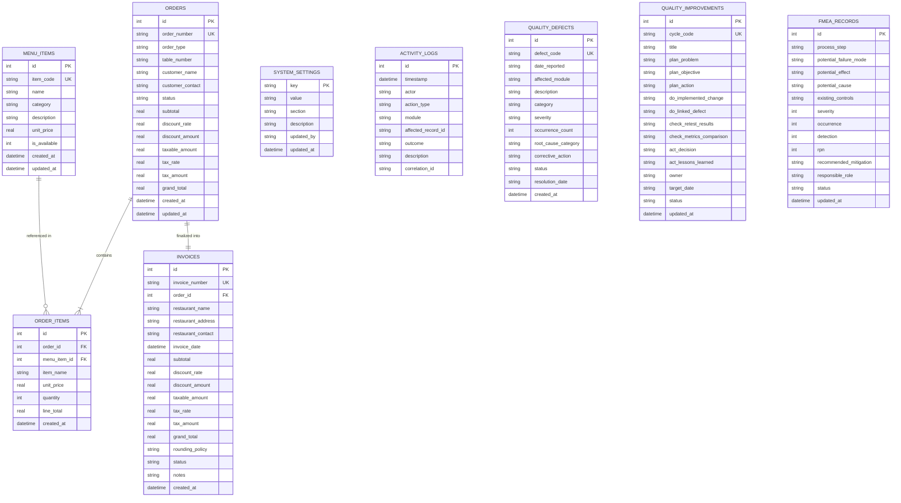

# Architecture and Technical Design Document
## Restaurant Billing System — TQM Q11: Improve Maintainability

**Student:** Swati Melkani (CSE - B, 2026-27)  
**Course:** BBAT104 — Fundamentals of Total Quality Management (TQM)  
**Assigned Quality Goal:** Q11 — Improve Maintainability  

---

## 1. Architectural Overview

The Restaurant Billing System follows a clean **Modular Layered Architecture** adhering to the Single Responsibility Principle (SRP) and Separation of Concerns (SoC).

```text
[ Browser Client ]
       │ HTTP GET / POST
       ▼
[ Routes Layer (app/routes/) ]
  ├── dashboard.py, menu.py, orders.py, billing.py, settings.py, logs.py, quality.py
       │ Calls Python Service Functions
       ▼
[ Service Layer (app/services/) ]
  ├── menu_service.py       <-- Business rules & validation
  ├── order_service.py      <-- Order cart & status transitions
  ├── billing_service.py    <-- Decimal calculation & ACID finalization
  ├── settings_service.py   <-- In-memory cache & setting updates
  ├── logging_service.py    <-- Dual-tier audit & technical logging
  └── quality_service.py    <-- Pareto, FMEA, Ishikawa, PDCA logic
       │ Parametrized SQL Queries & Transactions
       ▼
[ Database Layer (app/database/) ]
  ├── connection.py         <-- Connection pooling via flask.g & PRAGMA foreign_keys = ON
  ├── schema.sql            <-- Tables, constraints, checks, indexes
  └── migrations.py         <-- Bootstrap schema & baseline data seed
       │ Read / Write
       ▼
[ Persistent Storage ]
  ├── SQLite3 DB (`instance/restaurant.db`)
  └── Rotating Diagnostic Log (`logs/app.log`)
```

---

## 2. Database Entity-Relationship (ER) Diagram



---

## 3. Configuration Management Strategy (Q11 Feature 2)

Configuration follows a strict hierarchy of precedence:
1. **Dynamic Business Settings (Database `system_settings` table):** Parameters editable through the administrative interface (Tax rate, Currency symbol, Max discount, Restaurant profile).
2. **Environment Variables (`.env` file):** Local secrets, host/port bindings, and file path directives.
3. **Application Configuration (`app/config.py`):** Structured configuration classes (`DevelopmentConfig`, `TestingConfig`, `ProductionConfig`).
4. **Fallback Hardcoded Defaults:** Embedded as defensive fail-safes in case settings are missing.

---

## 4. Dual-Tier Logging Strategy (Q11 Feature 4)

| Logging Tier | Target Storage | Purpose | Access Level |
|--------------|----------------|---------|--------------|
| **Business Audit Logs** | SQLite `activity_logs` table | Tracks business transactions: item additions, bill finalizations, setting updates. | Accessible via Web UI (`/logs`) for managers and auditors. |
| **Technical Diagnostic Logs** | `logs/app.log` (RotatingFileHandler, max 1MB, 5 backups) | Captures application initialization, stack traces, and database connection events. | Technical administrators and developers via server filesystem. |

### Sensitive Payload Redaction
All logging endpoints call `sanitize_message()` to ensure sensitive information (e.g. passwords, authentication tokens, payment details) are converted to `[REDACTED]` before storage.

---

## 5. Code Maintainability Checklist

- [x] **Separation of Concerns:** Route handlers perform zero arithmetic or raw database writes; all logic is delegated to `services/`.
- [x] **No Magic Numbers:** Status strings, calculation constants, and rounding rules are declared in constants or loaded from settings.
- [x] **Strict Input Validation:** All numbers and text fields are validated on the server; client-side checks only exist for user convenience.
- [x] **Idempotent Database Bootstrap:** Schema creation (`init_db`) and baseline seeding (`seed_default_settings`) can run repeatedly without error.
- [x] **Isolated Automated Testing:** Test suite runs against `:memory:` database without corrupting the development database.
- [x] **Type Hints & Docstrings:** Every public function and service module includes complete Python docstrings and type annotations.
